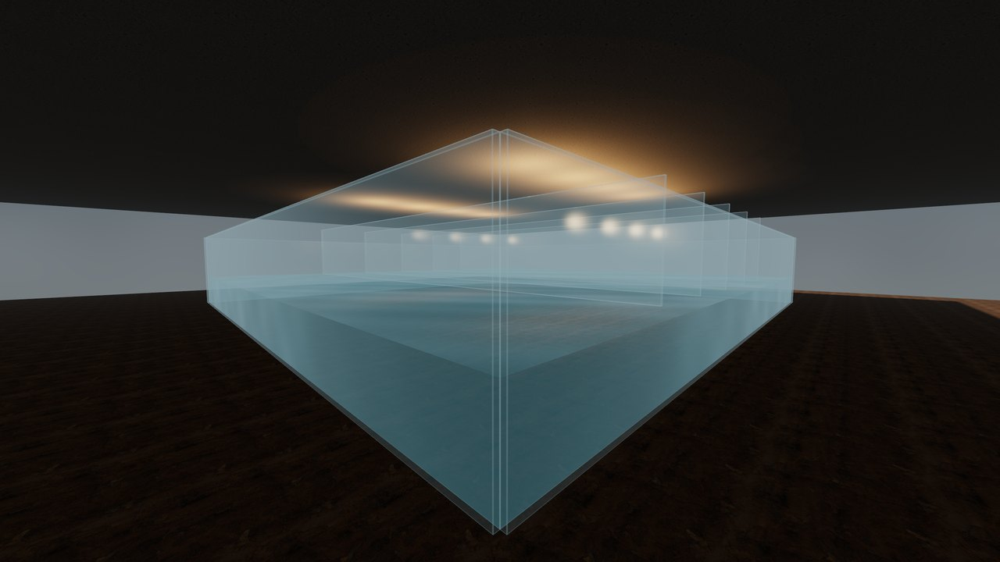

<h1 align="center">Sauerteig</h1>

<p align="center">
  A co-op cube editor and arena shooter modeled on Cube 2: Sauerbraten,
  written in Rust for desktop and WebGPU browsers.
</p>

<p align="center">
  <a href="https://github.com/zachmeador/sauerteig/actions/workflows/ci.yml"></a>
  <a href="LICENSE"></a>
</p>

> [!WARNING]
> **Project status: slop-cannon experimentation.** Nearly all of Sauerteig is
> written by AI coding agents while one human steers, playtests, and vetoes.
> It is a prototype. Save formats, the network protocol, and controls can change
> at any time, and big pieces get rewritten along the way. There is no
> authentication or moderation, so don't open a server to strangers, and back up
> any world you care about.


Sauerteig is built around Sauerbraten's coop edit mode, where several players
edit the same map at once and can switch to fighting in it at any time. It has an
authoritative server, a native client, and a WebGPU client that runs in a browser.

## What works today

- **Shared editing.** Everyone builds in the same world at once. The server
  validates every edit, and each player's undo and redo refuse to overwrite
  anyone else's newer work.
- **Sauerbraten-style cube editing.** Drag to select faces, scroll to
  extrude or carve, shape corners and edges, and paint per-face materials on a
  grid from 8 m down to 1/8 m. Multi-volume selections, copy and paste with
  rotate and mirror, water and glass volumes, props, light nodes, and a blueprint
  library for reusing builds.
- **Combat.** Press **E** to switch between editing and fighting. There are two
  weapons, a hitscan gun and a rocket launcher.
- **Desktop and browser together.** The native client and the WebGPU browser
  client join the same rooms, up to 16 players each.
- **Self-hosted, no accounts.** The desktop app keeps named worlds and starts a
  local server when you open one. Tick a box to host on your LAN, or run the
  standalone server.
- **Rendering.** Linear HDR with filmic tonemapping and bloom, clustered
  forward lighting for up to 256 lights in view, a cached shadow atlas,
  transparent water and glass, and GPU-instanced props.
- **Cube 2 map import.** A command-line importer turns `.ogz` maps (OCTA
  versions 29–33) into editable worlds: geometry, water and glass, and light and
  spawn positions. Original textures, models, and entities don't come across yet.

<p align="center">
  
  
  
</p>
<p align="center"><sub>Renderer test scenes from the built-in headless capture tool, with placeholder art.</sub></p>

## Try it

Install [Rust](https://rustup.rs/). Linux also needs a few
[system libraries](docs/development.md#linux-dependencies).

```sh
git clone https://github.com/zachmeador/sauerteig.git
cd sauerteig
cargo run --release -p sauerteig-client
```

Choose **New world** to start building. Opening a world starts its server
automatically. Enable LAN hosting to let other computers on your network join
through **Join server**. On macOS, `./scripts/build-macos-app.sh` packages an
unsigned `.local/Sauerteig.app` that includes the browser client.

### In a browser

```sh
rustup target add wasm32-unknown-unknown
cargo install wasm-bindgen-cli --version 0.2.100 --locked
./scripts/build-web.sh
cargo run --release -p sauerteig-server
```

Open **http://localhost:3000/?name=Player** in a browser with WebGPU enabled.
Browser and native players share the same room. Browsers on other computers need
HTTPS and a secure WebSocket, so put the server behind your own TLS proxy. See
[development and hosting](docs/development.md#hosting-and-saves).

## Controls

| Key | Action |
| --- | --- |
| WASD, mouse | Move and look; fly in edit mode |
| E | Switch between building and fighting |
| Left click, Space | Fire and jump while fighting |
| Left drag | Select faces |
| Wheel | Extrude or carve the selection |
| G + wheel | Change the grid size |
| 1–8, T | Pick a material; browse materials and props |
| C, V | Copy and paste |
| B | Blueprints |
| U or Z | Undo; add Shift to redo |
| Ctrl+S or Cmd+S | Save the shared world |
| F1, F2 | All controls; settings |

The full list, including selections, corner shaping, and objects, is in the
[editor guide](docs/editor.md).

## Known limits

- No accounts, authentication, or moderation. Names are labels. Host for people
  you trust.
- Internet play means exposing a server yourself. Easier joining from home
  connections is planned but parked.
- A joining player receives the whole world as one message, so very large
  worlds can freeze a browser while they load.
- Imported maps keep their shape, not their look: textures, models, light
  settings, and gameplay entities aren't restored.
- Props are decoration with no collision.
- Combat networking, weapons, and modes are placeholders until the sandbox is
  solid.
- Most testing so far has been on one Apple Silicon Mac, with Linux builds in CI.
  Windows, integrated GPUs, and real internet connections need playtesting.

## Roadmap

Shared editing, the world format, and rendering come before combat. In priority
order:

1. **Shared sandbox:** streamed, compact joins for big worlds, then internet play.
2. **World format:** per-world settings for movement (including a port of
   Sauerbraten's), gravity, and sky; object and light properties; a material
   library with texture alignment.
3. **Renderer:** sun shadow cascades and quality tiers for weaker GPUs.
4. **Large worlds:** view distance, streaming, and traversal.
5. **Editor feel:** in-place selection transforms, Sauerbraten keymap parity, and
   a heightmap brush.
6. **Old-map restoration:** original textures, models, and lights.
7. **Game layer:** combat netcode, weapons, items, and modes.

Current status and work orders live in [docs/tracking](docs/tracking/README.md).

## How it's made

Sauerteig is also an experiment in AI-directed development. The maintainer sets
direction, plays the builds, and can veto anything. An AI design lead turns that
into staged work orders in [docs/tracking](docs/tracking/README.md). AI coding
sessions (Claude Code and OpenAI Codex) implement each stage on its own branch,
and the lead reviews the result, runs the checks, playtests the native and
browser builds, and merges. [AGENTS.md](AGENTS.md) holds the rules the agents
follow.

## Project layout

| Path | Contents |
| --- | --- |
| [`crates/core`](crates/core) | World geometry, meshing, collision, movement, and the wire protocol, with no graphics. Its [contract](crates/core/CONTRACT.md) lists the invariants. |
| [`crates/server`](crates/server) | The authoritative 60 Hz room simulation, edit validation and history, saves, and WebSockets. |
| [`crates/client`](crates/client) | Native and WebAssembly clients: the wgpu renderer, egui interface, editor, and prediction. |
| [`crates/importer`](crates/importer) | The Cube 2 map reader and converter, with [usage and limits](crates/importer/README.md). |
| [`web`](web) | The browser page around the WebAssembly client. |
| [`assets`](assets) | CC0 [materials](assets/materials/README.md) and [props](assets/props/README.md) with source manifests. |

The [development guide](docs/development.md) covers building, hosting, saves,
rendering, and performance tools. Design research lives in [research](research).

## Contributing

The most useful contribution right now is playing it and reporting what broke or
felt wrong. Open an issue with what happened and your OS, GPU, and browser. Small
pull requests are welcome; for anything larger, open an issue first, because the
direction in [docs/tracking](docs/tracking/README.md) moves fast. CI checks
formatting, runs Clippy with warnings denied, runs the workspace tests, and builds
the native and browser clients. The
[development guide](docs/development.md#build-and-check) has the commands.

## Credits

- [Cube 2: Sauerbraten](http://sauerbraten.org/) by Wouter van Oortmerssen, Lee
  Salzman, and contributors, and Lee Salzman's [Tesseract](http://tesseract.gg/),
  which Sauerteig is modeled on. The Sauerbraten movement model here is a port of
  the engine's zlib-licensed physics code.
- [Poly Haven](https://polyhaven.com/) for the CC0 textures and models.

Sauerteig is an independent project. It is not affiliated with or endorsed by the
Sauerbraten or Tesseract developers.

## License

Code and documentation are [MIT licensed](LICENSE). The bundled materials and
props are CC0, and their manifests record sources and modifications. See the
[third-party notices](THIRD_PARTY_NOTICES.md).
