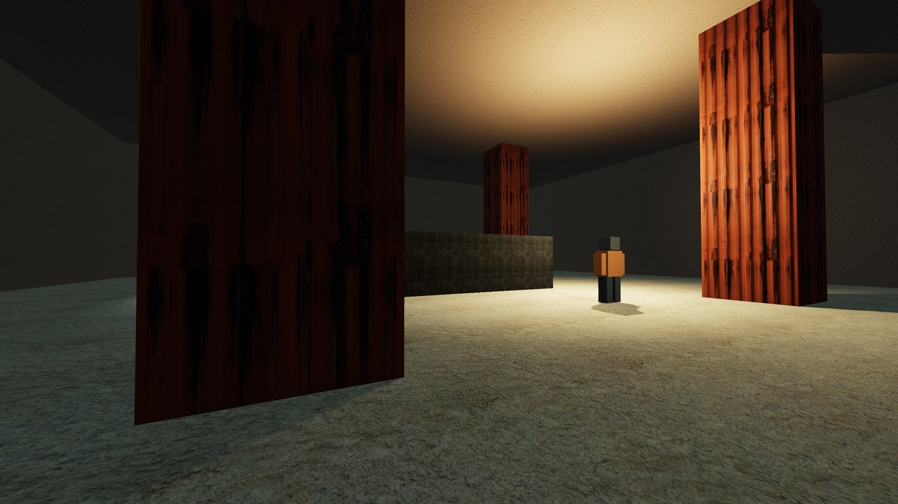
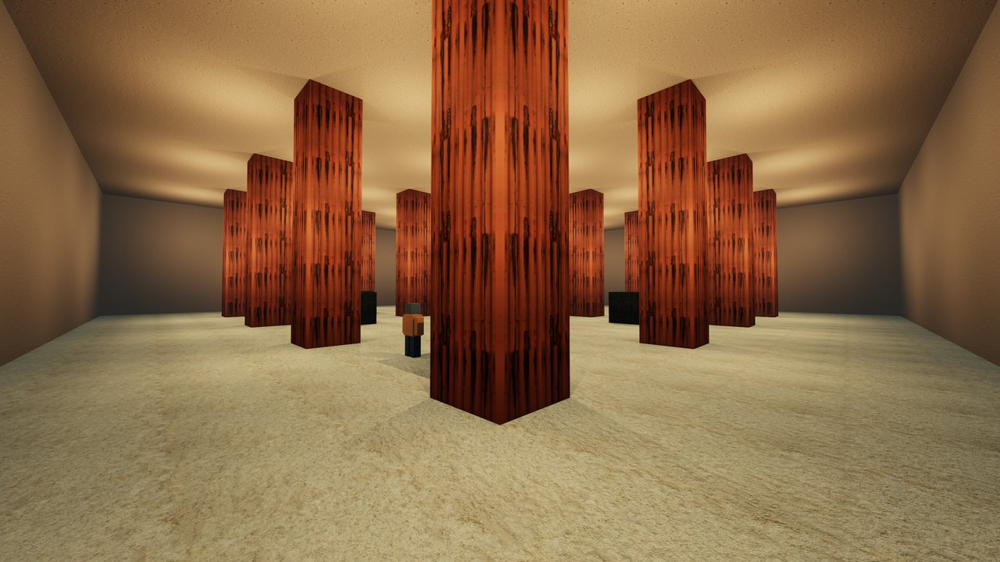
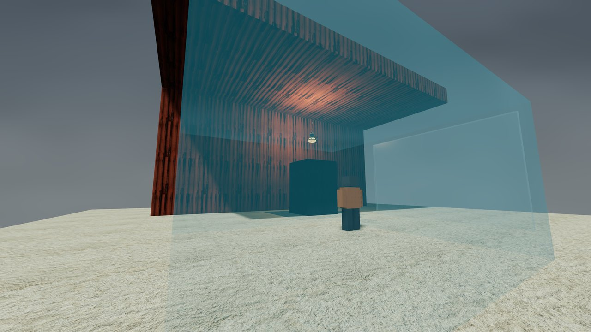

<h1 align="center">Sauerteig</h1>

<p align="center">
  A co-op cube editor and arena shooter modeled on Cube 2: Sauerbraten,
  written in Rust. It runs on desktop and in browsers that support WebGPU.
</p>

<p align="center">
  <a href="https://github.com/zachmeador/sauerteig/actions/workflows/ci.yml"></a>
  <a href="LICENSE"></a>
</p>

> [!WARNING]
> **Project status: slop-cannon experimentation.** Nearly all of Sauerteig is
> written by AI coding agents while one human steers, playtests, and vetoes.
> It is a prototype. Save formats, the network protocol, and controls can change
> at any time, and big pieces get rewritten along the way. There is no
> authentication or moderation, so don't open a server to strangers. Back up any
> world you care about.



Sauerteig is built around Sauerbraten's coop edit mode, where several players
edit the same map at once and can switch to fighting in it at any time.

## What works today

- **Shared editing.** Changes show up for everyone right away. Undo and redo
  only touch your own edits, and are refused if someone else has changed the
  same spot since.
- **Sauerbraten-style cube editing.** Drag to select faces, scroll to extrude or
  carve, shape corners and edges, and give each face its own material. The grid
  goes from 8 m down to 1/8 m. You can select several areas at once and paste
  copies rotated or mirrored. You can also fill spaces with water or glass, place
  props and lights, and save builds as blueprints to reuse.
- **Combat.** Press **E** to switch between editing and fighting. There are two
  weapons, a rifle and a rocket launcher; press 1 or 2 to switch.
- **Up to 16 players.** Desktop and browser players can join the same server.
- **Self-hosted.** The desktop app keeps your worlds and starts a server when you
  open one. You can let other computers on your local network join, or run the
  server on its own without the desktop app.
- **Lighting.** Lights cast shadows, and up to about 150 in view can shine at
  once. Past that, the farthest ones fade out.
- **Cube 2 map import.** A command-line [importer](crates/importer/README.md)
  turns `.ogz` maps (map format versions 29–33) into editable worlds. It keeps
  the geometry, water, glass, and the positions of lights and spawn points.

<p align="center">
  
  
  
</p>
<p align="center"><sub>Test scenes with placeholder art.</sub></p>

## Try it

There are no downloads yet, so you build Sauerteig yourself. Install
[Rust](https://rustup.rs/). Linux also needs a few
[system libraries](docs/development.md#linux-dependencies).

```sh
git clone https://github.com/zachmeador/sauerteig.git
cd sauerteig
cargo run --release -p sauerteig-client
```

Choose **New world** to start building. Opening a world starts its server
automatically. To let other computers on your network join, tick
**Allow players on my local network** before you open the world. They can then
connect through **Join server**. Worlds are saved in `~/Library/Application Support/Sauerteig/worlds` on
macOS, `%LOCALAPPDATA%\Sauerteig\worlds` on Windows, and
`~/.local/share/sauerteig/worlds` on Linux. Copy that folder to back them up.

On a Mac you can also build an app to double-click. The app includes the browser
version, so first run the first two commands under [In a browser](#in-a-browser).
Then run `./scripts/build-macos-app.sh` and `open .local/Sauerteig.app`. The app
works from anywhere, so you can move it out of the hidden `.local` folder into
Applications.

### In a browser

```sh
rustup target add wasm32-unknown-unknown
cargo install wasm-bindgen-cli --version 0.2.100 --locked
./scripts/build-web.sh
cargo run --release -p sauerteig-server
```

Open **http://localhost:3000/?name=Player** in a browser with WebGPU enabled.
Browser and desktop players join the same world. Browsers on other computers
only allow WebGPU over HTTPS, so put the server behind an HTTPS proxy of your
own that also passes WebSocket connections on `/ws`. See
[development and hosting](docs/development.md#hosting-and-saves).

## Controls

| Key | Action |
| --- | --- |
| WASD, mouse | Move and look; fly in edit mode |
| E | Switch between building and fighting |
| Left click, Space | Fire and jump while fighting |
| Left drag | Select faces |
| Wheel | Extrude or carve the selection |
| G + wheel | Change the grid size |
| 1–8, T | Pick a material; browse materials and props |
| C, V | Copy and paste |
| B | Save or load blueprints |
| U or Z | Undo; add Shift to redo |
| Ctrl+S or Cmd+S | Save the shared world |
| Esc | Free the mouse and open the menu |
| F1, F2 | Show all controls; open settings |

The full list, including selections, corner shaping, and objects, is in the
[editor guide](docs/editor.md).

## Known limits

- There are no accounts or moderation, and anyone can join under any name. Host
  only for people you trust.
- Playing over the internet means running the standalone server and forwarding a
  port on your router yourself, and browsers on other computers also need HTTPS.
  An easier way is planned but on hold.
- A joining player receives the whole world as one message, so very large
  worlds can freeze a browser while they load.
- Imported maps lose their textures, models, light settings, and gameplay
  objects such as pickups.
- Movement doesn't match Sauerbraten's yet. A port of its movement code exists
  but isn't switched on.
- Props are decoration with no collision.
- Combat is a stand-in: two weapons, and no items, teams, or game modes.
- Most testing so far has been on one Apple Silicon Mac; Linux is only built and
  tested automatically. Windows, integrated GPUs, and real internet connections
  need playtesting.

## Roadmap

Listed in priority order. Combat comes last because it is easier to get right
once the rest of the game stops changing.

1. **Shared sandbox:** let players join big worlds without freezing, with a
   progress bar while the world loads. Easier internet play comes after that and
   is on hold for now.
2. **World format:** let each world set its own movement (Sauerbraten's
   included), gravity, and sky. Give each light its own color and range, and give
   other objects settings of their own. Add a material library that lets you
   shift, rotate, and scale each face's texture.
3. **Renderer:** make sun shadows reach farther, and lower the quality
   automatically on GPUs that can't keep up.
4. **Large worlds:** see farther, reach distant parts of big maps quickly while
   editing, and run well on ordinary laptops.
5. **Editor feel:** move, flip, and rotate selections in place. Match
   Sauerbraten's key bindings. Add a heightmap brush for raising and lowering
   terrain.
6. **Old-map restoration:** original textures, models, and light settings.
7. **Game layer:** combat networking, weapons, items, and game modes.

Current status and work orders live in [docs/tracking](docs/tracking/README.md).

## How it's made

An AI design lead breaks the maintainer's goals into stages and writes each one
up as a work order in [docs/tracking](docs/tracking/README.md). AI coding sessions (Claude Code and
OpenAI Codex) carry out each stage on its own branch. The lead then reviews the
work, runs the checks, plays it in the desktop and browser versions, and merges
it. [AGENTS.md](AGENTS.md) holds the rules the agents follow.

## Project layout

| Path | What it is |
| --- | --- |
| [`crates/core`](crates/core) | Game code that the client and server share: the world, collision, movement, and the messages they send each other. It doesn't depend on any graphics library. Its [contract](crates/core/CONTRACT.md) lists the rules other code can rely on. |
| [`crates/server`](crates/server) | The server that players connect to. It keeps the shared world and saves it to disk. It checks each edit before applying it, decides where players are and who got hit, and serves the browser version. |
| [`crates/client`](crates/client) | The game you run, as a desktop app or in a browser: graphics, menus, and the editor. The desktop app can host a server itself. |
| [`crates/importer`](crates/importer) | A command-line tool that converts Cube 2 maps. Its [README](crates/importer/README.md) covers usage and limits. |
| [`web`](web) | The web page that loads the browser version. |
| [`assets`](assets) | Free-to-use (CC0) [materials](assets/materials/README.md) and [props](assets/props/README.md), with a record of where each one came from. |

The [development guide](docs/development.md) covers building, hosting, saves,
rendering, and performance tools. Design research lives in [research](research).

## Contributing

The most useful contribution right now is playing it and reporting what broke or
felt wrong. Open an issue with what happened and your OS, GPU, and browser. Small
pull requests are welcome; for anything larger, open an issue first, because the
direction in [docs/tracking](docs/tracking/README.md) moves fast. CI checks
formatting, runs Clippy with warnings denied, runs the workspace tests, and builds
the native and browser clients. The
[development guide](docs/development.md#build-and-check) has the commands.

## Credits

- [Cube 2: Sauerbraten](http://sauerbraten.org/) (by Wouter van Oortmerssen, Lee
  Salzman, and contributors) and Lee Salzman's [Tesseract](http://tesseract.gg/),
  which Sauerteig is modeled on. The Sauerbraten movement model here is a port of
  the engine's zlib-licensed physics code.
- [Poly Haven](https://polyhaven.com/) for the CC0 textures and models.

Sauerteig is an independent project. It is not affiliated with or endorsed by the
Sauerbraten or Tesseract developers.

## License

Code and documentation are [MIT licensed](LICENSE). The bundled materials and
props are CC0, and their manifests record sources and modifications. See the
[third-party notices](THIRD_PARTY_NOTICES.md).
